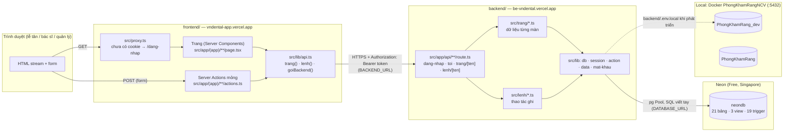
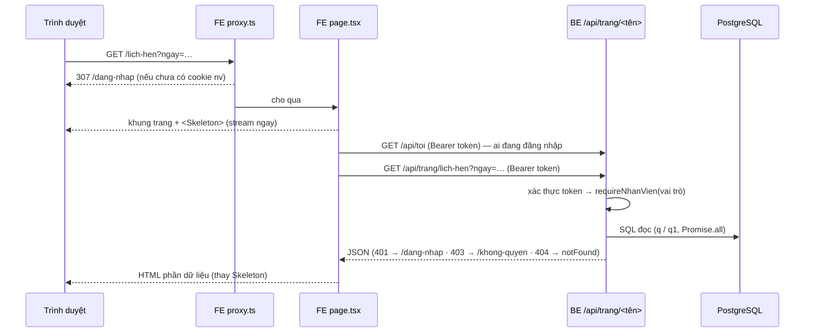
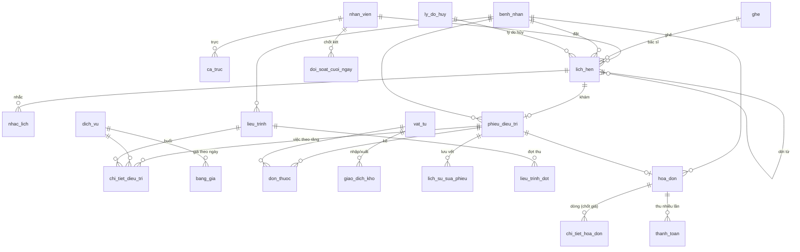

# Kiến trúc hệ thống — Phòng khám Nha khoa Nụ Cười Việt

> Website quản lý phòng khám: frontend https://vndental-app.vercel.app · backend https://be-vndental.vercel.app · CSDL PostgreSQL (Neon ở production, Docker `PhongKhamRangNCV` khi phát triển). Tài liệu này phải được cập nhật cùng mọi thay đổi tính năng — xem [.claude/rules/cap-nhat-kien-truc.md](../.claude/rules/cap-nhat-kien-truc.md).
>
> Tài liệu nghiệp vụ (trên Google Drive, thư mục `Thuc_Hanh_Buoi_3`): `.claude/docs/use-case.md` (23 use case, luật L1–L14, giả định G1–G15) · `database/quyet-dinh.md` (QĐ1–QĐ3, P1–P16) · `wireframe/phong-kham-rang.drawio` (20 trang màn hình).

## 1. Tổng quan

| Hạng mục | Nội dung |
| --- | --- |
| Người dùng | Lễ tân (2), bác sĩ (4, một người bán thời gian), quản lý (1). Bệnh nhân không đăng nhập (G1). |
| Chức năng | Lịch hẹn theo ghế × khung 30', nhắc lịch, tiếp nhận, hồ sơ bệnh nhân, phiếu điều trị theo răng (FDI), đơn thuốc, vật tư, liệu trình trả theo đợt, hóa đơn thu nhiều lần, đối soát két, ca trực, bảng giá theo ngày hiệu lực, công nợ, kho, báo cáo 8 câu hỏi tháng, nhân viên & danh mục. |
| Kiến trúc | **Tách frontend / backend**: hai ứng dụng Next.js 16 deploy riêng. Frontend (`frontend/`) chỉ dựng giao diện (Server Components + Server Action mỏng); backend (`backend/`) là API JSON giữ toàn bộ truy cập CSDL, mật khẩu và phiên. Không ORM. |
| Nguyên tắc | Luật nghiệp vụ đặt ở CSDL (CHECK, UNIQUE, EXCLUDE, trigger, view) — ứng dụng chỉ hiển thị và đổi lỗi CSDL thành câu tiếng Việt. Không xóa cứng dữ liệu nghiệp vụ (L12, G10). |
| Mã nguồn | `C:\Projects\phong-kham-rang` (ổ C, không đặt trên Google Drive để npm / Next chạy nhanh). |

## 2. Sơ đồ tổng thể

Hai project Next.js 16 riêng, deploy riêng trên Vercel (vùng `sin1`). **Chỉ backend nối CSDL và giữ khóa phiên**; frontend gọi backend **server-to-server** (trình duyệt không gọi thẳng backend → không cần CORS).



| Thành phần | Production | Local |
| --- | --- | --- |
| Frontend | https://vndental-app.vercel.app (project Vercel `vndental-app`) | http://localhost:3000 (`cd frontend && npm run dev`) |
| Backend | https://be-vndental.vercel.app (project Vercel `bevndental`) | http://localhost:3001 (`cd backend && npm run dev`) |
| CSDL | Neon `ep-crimson-surf-ao89clrc(-pooler).c-2.ap-southeast-1.aws.neon.tech`, database `neondb` | Docker `PhongKhamRang_dev` (kiểm thử) / `PhongKhamRang` |

## 3. Cấu trúc thư mục

```text
phong-kham-rang/
├─ frontend/                Giao diện — KHÔNG có chuỗi kết nối CSDL, KHÔNG có SESSION_SECRET
│  ├─ src/proxy.ts          Chặn khi chưa có cookie, chuyển trang chủ theo vai trò
│  ├─ src/lib/
│  │  ├─ api.ts             trang(<tên>, tham số) → GET /api/trang/<tên>; lenh(<tên>, FormData) → POST /api/lenh/<tên>
│  │  ├─ session.ts         getNhanVien() (GET /api/toi, cache theo request), requireNhanVien() chỉ để chuyển trang
│  │  ├─ session-cookie.ts  Cookie nv (token do backend cấp) + vt; luuPhien / xoaPhien
│  │  ├─ action.ts          Kiểu ActionState     · data.ts  Kiểu + hàm thuần (sdtDep, trongCa…) · format.ts
│  ├─ src/kieu/             TỰ SINH từ backend (npm run sinh-kieu): kiểu dữ liệu từng màn — không sửa tay
│  ├─ src/components/       ActionForm, NavLink, Skeleton, PrintButton, ui
│  └─ src/app/
│     ├─ dang-nhap/         Form tên đăng nhập + mật khẩu → POST /api/dang-nhap → cookie
│     └─ (app)/<route>/     page.tsx (dựng giao diện từ trang('<route>')) + actions.ts (mỗi hàm = lenh('<tên>'))
├─ backend/                 API + CSDL
│  ├─ src/app/route.ts      GET / → mô tả dịch vụ (JSON)
│  ├─ src/app/api/          dang-nhap/ · toi/ · trang/[ten]/ · lenh/[ten]/  (route.ts)
│  ├─ src/trang/            1 file / màn: hàm (sp) → dữ liệu; index.ts = bảng tra TRANG
│  ├─ src/lenh/             Thao tác ghi theo nhóm màn; index.ts = bảng tra LENH (tên hàm phải duy nhất)
│  ├─ src/lib/              db (Pool, q, q1, tx) · session (token HMAC, requireNhanVien qua AsyncLocalStorage)
│  │                        api (xuLy: token → nhân viên → JSON) · ket-qua (LoiApi, redirect, notFound)
│  │                        action (run, loiTiengViet) · data (truy vấn dùng chung) · mat-khau (scrypt) · format
│  ├─ db/                   schema.sql · seed.sql · bao-cao.sql
│  └─ scripts/              db-init.mjs · dat-mat-khau.mjs · sinh-kieu.mjs
├─ scripts/                 smoke.ps1 (mọi route theo vai trò, cookie ký HMAC) · e2e.py (26 bước trên Edge)
├─ docs/kien-truc.md        Tài liệu này
├─ .claude/rules/           Quy tắc cho Claude: cập nhật kiến trúc, ranh giới frontend / backend
└─ .github/                 PR template + workflow chặn PR thiếu cập nhật kiến trúc
```

Mỗi thư mục `frontend/`, `backend/` là một project npm riêng (`npm install` riêng), có `.env.local` riêng (không commit) và `.vercel/` riêng (đã link project Vercel).

## 4. Màn hình, route và use case

| Màn (wireframe) | Route | Vai trò | Use case | Bảng / view chính |
| --- | --- | --- | --- | --- |
| 01 Lịch hẹn theo ngày | `/lich-hen` | Lễ tân, bác sĩ | UC01, UC02, UC04 | `lich_hen`, `ca_truc`, `ghe` |
| 02 Đặt lịch hẹn | `/lich-hen/dat` | Lễ tân, bác sĩ | UC02 (+UC01, UC06) | `lich_hen`, `benh_nhan`, `v_lieu_trinh_dang_do` |
| 04 Hủy / dời lịch | `/lich-hen/[id]` | Lễ tân, bác sĩ | UC04 | `lich_hen`, `ly_do_huy`, `nhac_lich` |
| 05 Nhắc lịch | `/nhac-lich` | Lễ tân | UC03 | `nhac_lich`, `lich_hen` |
| 06 Tiếp nhận | `/tiep-nhan` | Lễ tân | UC05, UC06 | `lich_hen`, `benh_nhan`, `phieu_dieu_tri` |
| 07 Hồ sơ bệnh nhân | `/benh-nhan`, `/benh-nhan/[id]` | Lễ tân, bác sĩ | UC06, UC07 | `benh_nhan` + mọi bảng theo người |
| 03 Tạo hồ sơ | `/benh-nhan/moi` | Lễ tân, bác sĩ | UC07 | `benh_nhan` |
| 08 Phiếu điều trị | `/phieu-dieu-tri`, `/phieu-dieu-tri/[id]` | Bác sĩ (lễ tân chỉ xem) | UC08–UC12 | `phieu_dieu_tri`, `chi_tiet_dieu_tri`, `don_thuoc`, `giao_dich_kho` |
| 09 Lịch sử sửa phiếu | khối trong `/phieu-dieu-tri/[id]` | Bác sĩ, quản lý | UC14 | `lich_su_sua_phieu` |
| 10 Liệu trình | `/lieu-trinh`, `/lieu-trinh/moi`, `/lieu-trinh/[id]` | Bác sĩ, lễ tân | UC13 | `lieu_trinh`, `lieu_trinh_dot` |
| 11–12 Hóa đơn & thu tiền | `/hoa-don`, `/hoa-don/[id]` | Lễ tân | UC15, UC16 | `hoa_don`, `chi_tiet_hoa_don`, `thanh_toan`, `v_cong_no_hoa_don` |
| 13 Đối soát cuối ngày | `/doi-soat` | Lễ tân | UC17 | `doi_soat_cuoi_ngay`, `thanh_toan` |
| 14 Ca trực | `/ca-truc` | Quản lý | UC18 | `ca_truc` |
| 15 Bảng giá | `/bang-gia` | Quản lý | UC19 | `bang_gia`, `doi_gia()` |
| 16 Công nợ | `/cong-no` | Quản lý | UC20 | `v_cong_no_hoa_don` |
| 17 Kho thuốc & vật tư | `/kho` | Quản lý | UC21 | `vat_tu`, `giao_dich_kho`, `v_vat_tu_sap_het` |
| 18 Báo cáo tháng | `/bao-cao` | Quản lý | UC22 | truy vấn như `db/bao-cao.sql` |
| 19 Nhân viên & danh mục | `/danh-muc?tab=nhan_vien\|dich_vu\|ghe\|ly_do` | Quản lý | UC23 | `nhan_vien`, `dich_vu`, `ghe`, `ly_do_huy` |
| — Đăng nhập | `/dang-nhap` | Mọi người | — | `nhan_vien` (`ten_dang_nhap`, `mat_khau_hash`) |
| — Đổi mật khẩu | `/doi-mat-khau` | Mọi vai trò | — | `nhan_vien.mat_khau_hash` |
| — | `/dang-nhap`, `/khong-quyen` | Tất cả | — | `nhan_vien` |

Quản lý có toàn quyền của lễ tân và bác sĩ (G7). Trang chủ theo vai trò: lễ tân `/lich-hen`, bác sĩ `/phieu-dieu-tri`, quản lý `/bao-cao`.

## 5. Luồng xử lý

### 5.1 Đọc dữ liệu (trang)



- Mỗi màn có một hàm ở `backend/src/trang/<tên>.ts` nhận `sp` (searchParams + params của route) và trả object dữ liệu; frontend gọi `trang('<tên>', await searchParams)` rồi dựng JSX như cũ.
- Kiểu dữ liệu frontend nhận được **sinh tự động** từ các hàm đó (`cd backend && npm run sinh-kieu` → `frontend/src/kieu/`). Đổi dữ liệu trả về ở backend thì chạy lại lệnh này; `tsc` ở frontend sẽ báo chỗ lệch.
- Phần tính toán chỉ để hiển thị (gom nhóm, phần trăm, khung giờ trống…) vẫn nằm ở frontend.

### 5.2 Ghi dữ liệu (lệnh)

```mermaid
sequenceDiagram
  participant B as ActionForm (client)
  participant A as FE actions.ts ('use server')
  participant L as BE /api/lenh/<tên>
  participant T as BE lib/db.tx()
  participant D as PostgreSQL (trigger, ràng buộc)
  B->>A: FormData
  A->>L: POST multipart (Bearer token)
  L->>L: requireNhanVien(vai trò) + batBuoc(...)
  L->>T: tx(nv.id, fn)
  T->>D: BEGIN; set_config('app.nhan_vien_id', nv.id, true); INSERT / UPDATE …; COMMIT / ROLLBACK
  L-->>A: { ok } | { error: câu tiếng Việt } | { redirect: url } | { ok, token }
  A-->>B: refresh() / redirect() / lưu token mới vào cookie
```

- Frontend `actions.ts` chỉ còn `return lenh('<tênHàm>', fd)`; xử lý thật ở `backend/src/lenh/<nhóm>.ts`, tra theo tên trong `LENH`.
- `run()` (backend `lib/action.ts`) đổi lỗi PostgreSQL thành câu tiếng Việt (bảng `RANG_BUOC`); `redirect()` của backend (`lib/ket-qua.ts`) trả `{ redirect }` để frontend chuyển trang.
- `app.nhan_vien_id` cho trigger biết ai sửa phiếu (L13), ai xuất kho, ai đổi giá.

## 6. Xác thực và phân quyền

- **Đăng nhập:** frontend `/dang-nhap` gửi form sang `POST /api/dang-nhap`. Backend kiểm mật khẩu **scrypt** (N=16384, r=8, p=1, salt 16 byte; `nhan_vien.mat_khau_hash` dạng `scrypt$N$r$p$salt$hash` — `backend/src/lib/mat-khau.ts`), sai tên hay sai mật khẩu báo chung một câu, cùng thời gian xử lý. Đúng → trả **token** `<id>.<hết hạn>.<HMAC-SHA256(SESSION_SECRET, id.hết hạn.mat_khau_hash)>`, 12 giờ.
- **Frontend** cất token trong cookie `nv` (httpOnly, SameSite=Lax, `Secure` ở production) và gửi lại ở header `Authorization: Bearer` mỗi lần gọi backend. Frontend không đọc / không tự tạo được token (không có `SESSION_SECRET`). Cookie `vt` chỉ để `proxy.ts` chọn trang chủ.
- **Backend** (`lib/api.ts` → `xuLy`) kiểm token với CSDL mỗi request (sai chữ ký / hết hạn / đã nghỉ việc / đổi mật khẩu → 401), đặt nhân viên hiện tại vào `AsyncLocalStorage`; mọi hàm trang / lệnh gọi `requireNhanVien(...roles)` (sai vai trò → 403). **Quyền thật nằm ở backend**; `requireNhanVien` ở frontend chỉ để chuyển trang cho đúng.
- **Mật khẩu:** `/doi-mat-khau` (lệnh `doiMatKhau` trả token mới, frontend ghi lại cookie; phiên trên máy khác hết hiệu lực). Quản lý: thêm nhân viên → mật khẩu tạm 12 ký tự hiện một lần; nút **Đặt lại** ở `/danh-muc`. Lần đầu / quản lý quên: `cd backend && node --env-file=<file> scripts/dat-mat-khau.mjs <ten_dang_nhap>`.
- Menu trái (`frontend/src/app/(app)/layout.tsx`) chỉ hiện mục của vai trò; số vật tư sắp hết lấy từ `/api/toi`.

## 7. Tầng dữ liệu (chỉ ở backend)

- `backend/src/lib/db.ts`: một `pg.Pool` (tối đa 5 kết nối), `q` / `q1` cho đọc, `tx(nhanVienId, fn)` cho ghi. Production: `sslmode` nâng thành `verify-full`, chờ kết nối 15 s (Neon Free tự ngủ), trả kết nối rảnh sau 10 s, `attachDatabasePool` (`@vercel/functions`).
- Kiểu dữ liệu: DATE / TIMESTAMP trả về **chuỗi** (tránh lệch múi giờ), NUMERIC / BIGINT trả về `number` — đi qua JSON sang frontend không đổi.
- Múi giờ `Asia/Ho_Chi_Minh` đặt ở cấp CSDL (`ALTER DATABASE … SET timezone`, do `scripts/db-init.mjs` chạy).
- Kết nối: `DATABASE_URL` — local trong `backend/.env.local`; production do tích hợp Neon cấp cho project Vercel `bevndental`.
- SQL viết tay, tham số `$1…$n`; không ORM. Truy vấn dùng chung ở `backend/src/lib/data.ts`.

## 8. Mô hình dữ liệu



### Luật nghiệp vụ nằm ở đâu

| Luật | Cơ chế trong CSDL | Ứng dụng làm gì |
| --- | --- | --- |
| L1 nhận biết bằng SĐT, trùng tên | `ix_benh_nhan_sdt`, `ux_benh_nhan_nguoi` (SĐT + họ tên + ngày sinh), CHECK định dạng SĐT | Tìm theo SĐT ra danh sách để chọn; báo trùng kèm mã hồ sơ cũ |
| L2 / L3 một lịch = 1 BS + 1 ghế + 1 khung; không trùng | CHECK phút :00/:30 + giờ mở cửa; `ux_lich_hen_ghe`, `ux_lich_hen_bac_si` (bỏ qua lịch hủy) | Lưới chỉ cho chọn khung / ghế trống; CSDL kiểm lại khi lưu |
| L4 nhiều việc, ghi số răng | `chi_tiet_dieu_tri` + CHECK FDI + trigger bắt buộc răng khi `dich_vu.theo_rang` | Sơ đồ răng FDI bấm để điền số răng |
| L5 giá theo thời gian | `bang_gia` + EXCLUDE daterange, `gia_tai_ngay()`, `doi_gia()`; giá chốt vào `chi_tiet_hoa_don` | Lập hóa đơn lấy giá ngày khám |
| L6 liệu trình trả theo đợt | `lieu_trinh`, `lieu_trinh_dot`, trigger tổng đợt ≤ trọn gói, `v_lieu_trinh_dang_do` | Buổi liệu trình không vào hóa đơn lẻ; thu theo đợt |
| L7 thuốc theo lần khám | `don_thuoc` + trigger chỉ kê thuốc + tự trừ kho | Kê nhầm → "Hoàn kho" (giao dịch điều chỉnh) |
| L8 / L9 thu nhiều lần, luôn biết còn nợ | `thanh_toan.hinh_thuc`, `v_cong_no_hoa_don`, trigger chặn thu quá, chặn sửa dòng khi đã thu | Gợi ý số còn nợ; hiện lỗi "chỉ còn nợ …" |
| L10 hủy ghi lý do, ai, lúc nào | CHECK đủ 4 trường khi `da_huy`; danh mục `ly_do_huy` | Form hủy bắt buộc lý do; dời lịch = hủy `doi_lich` + `doi_tu_lich_hen_id` |
| L11 lịch trong ca trực | trigger `kiem_tra_lich_hen`, `kiem_tra_sua_ca_truc`; `ca_truc` UNIQUE (người, ngày, buổi) + EXCLUDE chồng giờ | Lưới tô xám khung không có bác sĩ; không bỏ được ca đã có lịch |
| L12 giữ hồ sơ 5 năm | trigger `chan_xoa` trên bệnh nhân, lịch hẹn, phiếu, hóa đơn, thanh toán | Không có nút xóa; danh mục chỉ "tạm ngừng" |
| L13 sửa phiếu biết ai, lúc nào | trigger JSONB → `lich_su_sua_phieu` (không sửa / xóa được) | Khối "Lịch sử sửa phiếu" chỉ đọc |
| L14 trừ kho khi dùng, báo ngưỡng | chỉ đổi tồn qua `giao_dich_kho` (trigger cập nhật, chặn sửa / xóa), CHECK `ton_kho ≥ 0`, `v_vat_tu_sap_het` | Số món sắp hết hiện trên menu Kho |

## 9. Quy ước phát triển

- Tên bảng / cột tiếng Việt không dấu, snake_case; giao diện và thông báo lỗi tiếng Việt.
- **Màn mới:** (1) backend `src/trang/<tên>.ts` — `export async function x(sp: SP)`, dòng đầu `requireNhanVien(...)`, trả object dữ liệu; thêm vào `src/trang/index.ts`; (2) `cd backend && npm run sinh-kieu`; (3) frontend `page.tsx`: component async + `Page` bọc `<Suspense fallback={<Skeleton/>}>`, gọi `trang('<tên>', …)`.
- **Thao tác ghi mới:** backend `src/lenh/<nhóm>.ts` — `(_: ActionState, fd: FormData) => Promise<ActionState>`, kiểm vai trò, mọi câu ghi qua `tx(nv.id, …)`, tên hàm không trùng lệnh khác (đăng ký trong `src/lenh/index.ts`); frontend `actions.ts`: `return lenh('<tênHàm>', fd)`, gọi từ `<ActionForm>`.
- Frontend **không** import `pg`, không đọc `DATABASE_URL` / `SESSION_SECRET`; mọi dữ liệu đi qua `src/lib/api.ts`.
- Luật mới → thêm vào CSDL (CHECK / trigger) trước, rồi thêm câu tiếng Việt vào `RANG_BUOC` trong `backend/src/lib/action.ts`.
- Đổi schema: sửa `backend/db/schema.sql` **và** `database/schema.sql` trên Drive, ghi quyết định vào `database/quyet-dinh.md`.
- Trước khi báo xong (trong cả `backend/` và `frontend/`): `npm run typecheck`, `npx eslint src`, `npm run build`; rồi chạy 2 dev server và `scripts/smoke.ps1`, `python scripts/e2e.py`.

## 10. Môi trường và triển khai

| Thành phần | Giá trị |
| --- | --- |
| Node.js / Next.js | Node 24, Next.js 16.4.3, React 19.3; frontend thêm Tailwind CSS 4 + Cache Components |
| Frontend production | Project Vercel **`vndental-app`**, vùng `sin1` → **https://vndental-app.vercel.app**. Biến: `BACKEND_URL=https://be-vndental.vercel.app` (production, preview). Deploy: `cd frontend && vercel deploy --prod`. |
| Backend production | Project Vercel **`bevndental`** (trước tên `vndental`), vùng `sin1` → **https://be-vndental.vercel.app** (tên miền gắn thêm; `bevndental.vercel.app` đã thuộc người khác). Biến: `DATABASE_URL`, `DATABASE_URL_UNPOOLED` (tích hợp Neon tự đặt), `SESSION_SECRET` (ngẫu nhiên 48 byte, Sensitive). Deploy: `cd backend && vercel deploy --prod`. `vndental-five.vercel.app` (tên cũ) giờ trỏ vào backend. |
| CSDL production | **Neon gói Free**, Singapore (`ap-southeast-1`), PostgreSQL 18, database `neondb`, resource `vndental-db`. Dữ liệu chép từ `PhongKhamRang` ngày 13/11/2026 (`pg_dump -n public --no-owner` → `psql`), múi giờ `Asia/Ho_Chi_Minh`, extension `btree_gist`. Tự ngủ khi rảnh — lần gọi đầu chậm vài giây. Tải biến: `cd backend && vercel env pull <file> --environment=production` (**không** pull vào `.env.local`). |
| CSDL local | Docker `PhongKhamRangNCV` (`postgres:17`, `localhost:5432`): `PhongKhamRang` (thật, chủ `Sang_admin`) · `PhongKhamRang_dev` (kiểm thử — `npm run db:reset` chỉ được trỏ vào đây). pgAdmin 4 http://localhost:5050. |
| Biến local | `backend/.env.local`: `DATABASE_URL`, `SESSION_SECRET` (≥ 32 ký tự; đổi khóa = đăng xuất mọi người) · `frontend/.env.local`: `BACKEND_URL=http://localhost:3001`. Mẫu: `.env.example`. |
| Chạy local | `cd backend && npm install && npm run dev` (:3001) · `cd frontend && npm install && npm run dev` (:3000) |
| Lệnh CSDL (trong `backend/`) | `npm run db:init` · `node --env-file=.env.local scripts/db-init.mjs --seed` · `npm run db:reset` · `node --env-file=<file> scripts/dat-mat-khau.mjs <ten_dang_nhap>|--chua-dat` |
| Sinh kiểu cho frontend | `cd backend && npm run sinh-kieu` → `frontend/src/kieu/` (commit cùng thay đổi) |
| Kiểm thử | `powershell -File scripts/smoke.ps1` · `python scripts/e2e.py e2e-shots` (cần cả 2 dev server; CSDL `_dev`) |

## 11. Giới hạn hiện tại

- Chưa giới hạn số lần đăng nhập sai (mật khẩu tạm ngẫu nhiên 12 ký tự nên khó dò; mật khẩu tự đặt tối thiểu 8 ký tự). Chưa có xác thực 2 lớp.
- Chưa gửi SMS thật: nhắc lịch chỉ ghi nhận "đã gửi" (G14).
- Dòng đơn thuốc đã lưu không xóa được (giao dịch kho tham chiếu và bị khóa — P9); kê nhầm thì "Hoàn kho".
- Một cơ sở, không quản lý lương (G15). Báo cáo đọc trực tiếp CSDL, chưa có bộ nhớ đệm.

## 12. Nhật ký thay đổi

| Ngày | Thay đổi | Mục đã sửa |
| --- | --- | --- |
| 05/11/2026 | Dựng website Next.js 16 cho CSDL PhongKhamRang: 18 màn theo wireframe + màn 19 Nhân viên & danh mục (UC23); chuyển mã nguồn theo schema mới (ca có buổi, `ly_do_huy_ma` + danh mục lý do hủy, liên kết dời lịch `doi_tu_lich_hen_id`, phiếu có trạng thái hoàn tất, dị ứng tách khỏi tiền sử, xuất vật tư gắn phiếu, hoàn kho đơn thuốc bằng giao dịch điều chỉnh); seed mới tương đối theo ngày; CSDL kiểm thử `PhongKhamRang_dev`; smoke test + e2e 26 bước. | Tất cả |
| 13/11/2026 | Thêm quy tắc `.claude/rules/frontend-backend.md` (bản đồ frontend / backend, nơi đặt code) và trỏ từ CLAUDE.md; e2e.py đọc chuỗi kết nối từ `.env.local` thay vì ghi cứng. Không đổi kiến trúc. | 3, 12 |
| 13/11/2026 | Đưa CSDL `PhongKhamRang` lên Neon Free (Singapore) qua tích hợp Vercel, project `vndental`; `db.ts` thêm cấu hình production (verify-full, timeout, `attachDatabasePool`); thêm `@vercel/functions` 3.10.4; `.env.example` ghi cách lấy biến production. | 7, 10, 12 |
| 13/11/2026 | Đăng nhập bằng mật khẩu (scrypt) thay cho chọn nhân viên; cookie phiên ký HMAC (`SESSION_SECRET`), đổi mật khẩu làm hết hạn phiên cũ; màn `/doi-mat-khau`; quản lý đặt lại mật khẩu / mật khẩu tạm khi thêm nhân viên; `scripts/dat-mat-khau.mjs`; smoke + e2e đăng nhập theo cách mới; deploy app lên Vercel (`vndental`). | 3, 4, 6, 10, 11, 12 |
| 13/11/2026 | **Tách frontend / backend** thành 2 project Next.js deploy riêng: frontend `vndental-app.vercel.app` (giao diện, gọi API server-to-server qua `BACKEND_URL`), backend `be-vndental.vercel.app` (API JSON `/api/dang-nhap`, `/api/toi`, `/api/trang/<tên>`, `/api/lenh/<tên>`, giữ CSDL Neon + mật khẩu + `SESSION_SECRET`). Truy vấn 22 màn chuyển sang `backend/src/trang/`, 45 lệnh ghi sang `backend/src/lenh/`; kiểu dữ liệu sinh tự động sang `frontend/src/kieu/`. Phiên: token HMAC do backend cấp, frontend giữ trong cookie và gửi Bearer. | 1, 2, 3, 5, 6, 7, 9, 10, 12 |
