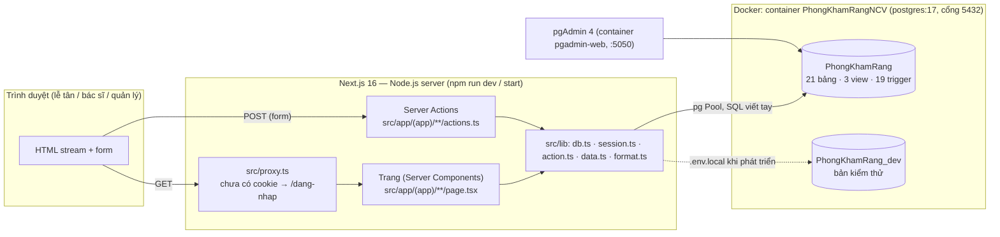
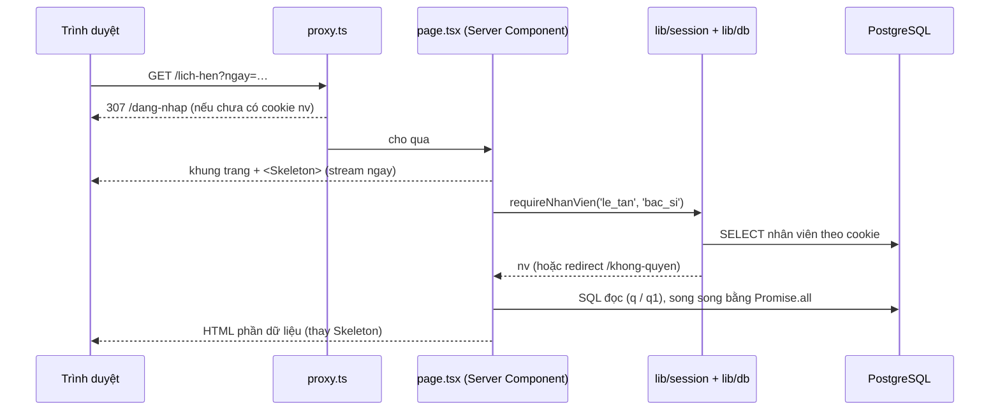
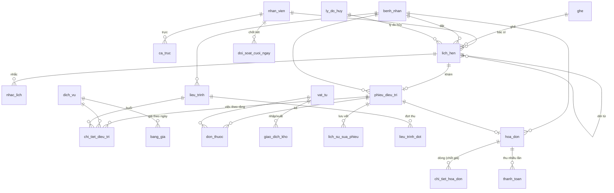

# Kiến trúc hệ thống — Phòng khám Nha khoa Nụ Cười Việt

> Website quản lý phòng khám trên CSDL **PhongKhamRang** (PostgreSQL 17 trong Docker). Tài liệu này phải được cập nhật cùng mọi thay đổi tính năng — xem [.claude/rules/cap-nhat-kien-truc.md](../.claude/rules/cap-nhat-kien-truc.md).
>
> Tài liệu nghiệp vụ (trên Google Drive, thư mục `Thuc_Hanh_Buoi_3`): `.claude/docs/use-case.md` (23 use case, luật L1–L14, giả định G1–G15) · `database/quyet-dinh.md` (QĐ1–QĐ3, P1–P16) · `wireframe/phong-kham-rang.drawio` (20 trang màn hình).

## 1. Tổng quan

| Hạng mục | Nội dung |
| --- | --- |
| Người dùng | Lễ tân (2), bác sĩ (4, một người bán thời gian), quản lý (1). Bệnh nhân không đăng nhập (G1). |
| Chức năng | Lịch hẹn theo ghế × khung 30', nhắc lịch, tiếp nhận, hồ sơ bệnh nhân, phiếu điều trị theo răng (FDI), đơn thuốc, vật tư, liệu trình trả theo đợt, hóa đơn thu nhiều lần, đối soát két, ca trực, bảng giá theo ngày hiệu lực, công nợ, kho, báo cáo 8 câu hỏi tháng, nhân viên & danh mục. |
| Kiến trúc | Một ứng dụng **Next.js 16 (App Router)** chạy trên Node.js: trang là React Server Component đọc thẳng CSDL; thao tác ghi là **Server Action**. Không có REST API riêng, không ORM. |
| Nguyên tắc | Luật nghiệp vụ đặt ở CSDL (CHECK, UNIQUE, EXCLUDE, trigger, view) — ứng dụng chỉ hiển thị và đổi lỗi CSDL thành câu tiếng Việt. Không xóa cứng dữ liệu nghiệp vụ (L12, G10). |
| Mã nguồn | `C:\Projects\phong-kham-rang` (ổ C, không đặt trên Google Drive để npm / Next chạy nhanh). |

## 2. Sơ đồ tổng thể



## 3. Cấu trúc thư mục

```text
phong-kham-rang/
├─ db/
│  ├─ schema.sql        Lược đồ PhongKhamRang (nguồn sự thật, giống database/schema.sql trên Drive)
│  ├─ seed.sql          Dữ liệu mẫu tương đối theo current_date (60 ngày lịch sử, 10 ngày tới)
│  └─ bao-cao.sql       8 truy vấn báo cáo tháng (UC22)
├─ scripts/
│  ├─ db-init.mjs       Tạo bảng (+ --seed) / --reset: xóa schema public rồi tạo lại
│  ├─ dat-mat-khau.mjs  Đặt mật khẩu nhân viên từ dòng lệnh (<ten_dang_nhap> [mat_khau] | --chua-dat)
│  ├─ smoke.ps1         Gọi mọi route theo vai trò (cookie ký HMAC): phải 200; không cookie: 307; cookie giả → /dang-nhap
│  └─ e2e.py            Kiểm thử đầu-cuối trên Edge (Playwright, đăng nhập bằng mật khẩu) + đối chiếu CSDL
├─ src/
│  ├─ proxy.ts          Chặn khi chưa đăng nhập, chuyển trang chủ theo vai trò
│  ├─ lib/              db (Pool, q, q1, tx) · session (requireNhanVien) · action (run, loiTiengViet)
│  │                    data (truy vấn dùng chung) · format (định dạng tiền, ngày, nhãn)
│  ├─ components/       ActionForm, NavLink, Skeleton, PrintButton, ui (Card, Tile, TrangThai, CanhBaoBN…)
│  └─ app/
│     ├─ layout.tsx     Font Be Vietnam Pro, tiếng Việt
│     ├─ dang-nhap/     Chọn nhân viên → cookie
│     └─ (app)/         Mọi màn sau đăng nhập; layout.tsx = menu trái lọc theo vai trò + thanh trên
│        └─ <route>/page.tsx (+ actions.ts, [id]/page.tsx, moi/page.tsx…)
├─ docs/kien-truc.md    Tài liệu này
├─ .claude/rules/       Quy tắc cho Claude: cập nhật kiến trúc, ranh giới frontend / backend
├─ .github/             PR template + workflow chặn PR thiếu cập nhật kiến trúc
└─ .env.local           DATABASE_URL (không commit)
```

## 4. Màn hình, route và use case

| Màn (wireframe) | Route | Vai trò | Use case | Bảng / view chính |
| --- | --- | --- | --- | --- |
| 01 Lịch hẹn theo ngày | `/lich-hen` | Lễ tân, bác sĩ | UC01, UC02, UC04 | `lich_hen`, `ca_truc`, `ghe` |
| 02 Đặt lịch hẹn | `/lich-hen/dat` | Lễ tân, bác sĩ | UC02 (+UC01, UC06) | `lich_hen`, `benh_nhan`, `v_lieu_trinh_dang_do` |
| 04 Hủy / dời lịch | `/lich-hen/[id]` | Lễ tân, bác sĩ | UC04 | `lich_hen`, `ly_do_huy`, `nhac_lich` |
| 05 Nhắc lịch | `/nhac-lich` | Lễ tân | UC03 | `nhac_lich`, `lich_hen` |
| 06 Tiếp nhận | `/tiep-nhan` | Lễ tân | UC05, UC06 | `lich_hen`, `benh_nhan`, `phieu_dieu_tri` |
| 07 Hồ sơ bệnh nhân | `/benh-nhan`, `/benh-nhan/[id]` | Lễ tân, bác sĩ | UC06, UC07 | `benh_nhan` + mọi bảng theo người |
| 03 Tạo hồ sơ | `/benh-nhan/moi` | Lễ tân, bác sĩ | UC07 | `benh_nhan` |
| 08 Phiếu điều trị | `/phieu-dieu-tri`, `/phieu-dieu-tri/[id]` | Bác sĩ (lễ tân chỉ xem) | UC08–UC12 | `phieu_dieu_tri`, `chi_tiet_dieu_tri`, `don_thuoc`, `giao_dich_kho` |
| 09 Lịch sử sửa phiếu | khối trong `/phieu-dieu-tri/[id]` | Bác sĩ, quản lý | UC14 | `lich_su_sua_phieu` |
| 10 Liệu trình | `/lieu-trinh`, `/lieu-trinh/moi`, `/lieu-trinh/[id]` | Bác sĩ, lễ tân | UC13 | `lieu_trinh`, `lieu_trinh_dot` |
| 11–12 Hóa đơn & thu tiền | `/hoa-don`, `/hoa-don/[id]` | Lễ tân | UC15, UC16 | `hoa_don`, `chi_tiet_hoa_don`, `thanh_toan`, `v_cong_no_hoa_don` |
| 13 Đối soát cuối ngày | `/doi-soat` | Lễ tân | UC17 | `doi_soat_cuoi_ngay`, `thanh_toan` |
| 14 Ca trực | `/ca-truc` | Quản lý | UC18 | `ca_truc` |
| 15 Bảng giá | `/bang-gia` | Quản lý | UC19 | `bang_gia`, `doi_gia()` |
| 16 Công nợ | `/cong-no` | Quản lý | UC20 | `v_cong_no_hoa_don` |
| 17 Kho thuốc & vật tư | `/kho` | Quản lý | UC21 | `vat_tu`, `giao_dich_kho`, `v_vat_tu_sap_het` |
| 18 Báo cáo tháng | `/bao-cao` | Quản lý | UC22 | truy vấn như `db/bao-cao.sql` |
| 19 Nhân viên & danh mục | `/danh-muc?tab=nhan_vien\|dich_vu\|ghe\|ly_do` | Quản lý | UC23 | `nhan_vien`, `dich_vu`, `ghe`, `ly_do_huy` |
| — Đăng nhập | `/dang-nhap` | Mọi người | — | `nhan_vien` (`ten_dang_nhap`, `mat_khau_hash`) |
| — Đổi mật khẩu | `/doi-mat-khau` | Mọi vai trò | — | `nhan_vien.mat_khau_hash` |
| — | `/dang-nhap`, `/khong-quyen` | Tất cả | — | `nhan_vien` |

Quản lý có toàn quyền của lễ tân và bác sĩ (G7). Trang chủ theo vai trò: lễ tân `/lich-hen`, bác sĩ `/phieu-dieu-tri`, quản lý `/bao-cao`.

## 5. Luồng xử lý

### 5.1 Đọc dữ liệu (trang)



Mỗi `page.tsx` gồm một component async làm việc thật và `export default function Page` bọc trong `<Suspense fallback={<Skeleton/>}>` (bắt buộc với Cache Components). Luồng nhiều bước (đặt lịch: bệnh nhân → bác sĩ & ngày → khung → ghế) dùng **searchParams + Link**, không có state phía client.

### 5.2 Ghi dữ liệu (Server Action)

```mermaid
sequenceDiagram
  participant B as ActionForm (client)
  participant A as actions.ts ('use server')
  participant T as lib/db.tx()
  participant D as PostgreSQL (trigger, ràng buộc)
  B->>A: FormData
  A->>A: requireNhanVien(vai trò) + batBuoc(...)
  A->>T: tx(nv.id, fn)
  T->>D: BEGIN; set_config('app.nhan_vien_id', nv.id, true)
  T->>D: INSERT / UPDATE …
  D-->>T: OK hoặc lỗi (CHECK, UNIQUE, EXCLUDE, RAISE trong trigger)
  T->>D: COMMIT / ROLLBACK
  A-->>B: { ok } + refresh()  hoặc  { error: câu tiếng Việt }
```

- `run()` trong `lib/action.ts` bọc thao tác, gọi `refresh()` để trang tải lại dữ liệu, đổi lỗi PostgreSQL thành câu tiếng Việt (bảng `RANG_BUOC` theo tên ràng buộc thật; lỗi `RAISE EXCEPTION` của trigger đã là tiếng Việt).
- Thao tác cần chuyển trang (đặt lịch, hủy rồi dời, lập hóa đơn) gọi `redirect()` **ngoài** khối `try`.
- `app.nhan_vien_id` cho trigger biết ai sửa phiếu (L13), ai xuất kho, ai đổi giá.

## 6. Xác thực và phân quyền

- **Đăng nhập** (`/dang-nhap`): tên đăng nhập + mật khẩu. Mật khẩu băm **scrypt** (N=16384, r=8, p=1, salt 16 byte) trong `nhan_vien.mat_khau_hash`, dạng `scrypt$N$r$p$salt$hash` — `src/lib/mat-khau.ts`. Sai tên hay sai mật khẩu báo chung một câu, cùng thời gian xử lý (hash giả). Không còn liệt kê nhân viên ở màn đăng nhập. `mat_khau_hash` NULL = chưa được vào.
- **Phiên** (`src/lib/session.ts`): cookie `nv` = `<id>.<hết hạn>.<chữ ký>`, chữ ký = HMAC-SHA256(`SESSION_SECRET`, `id.hết hạn.mat_khau_hash`); httpOnly, SameSite=Lax, `Secure` ở production, 12 giờ. Sửa tay id → sai chữ ký; đổi / đặt lại mật khẩu → mọi phiên cũ của người đó tự hết hiệu lực. Cookie `vt` chỉ để proxy chọn trang chủ, không dùng để phân quyền.
- **Mật khẩu:** `/doi-mat-khau` — mọi người tự đổi (≥ 8 ký tự, phải nhập đúng mật khẩu cũ). Quản lý: thêm nhân viên → sinh mật khẩu tạm 12 ký tự, hiện một lần; nút **Đặt lại** ở `/danh-muc` (nhân viên quên mật khẩu). Lần đầu / quản lý quên: `node --env-file=<file> scripts/dat-mat-khau.mjs <ten_dang_nhap>`.
- `src/proxy.ts`: mọi route trừ `/dang-nhap` cần có cookie `nv` (chỉ kiểm có/không); `/` chuyển về trang chủ theo vai trò.
- Quyền thật kiểm ở **từng trang và từng Server Action** bằng `requireNhanVien(...roles)`: đọc lại nhân viên từ CSDL (đã nghỉ việc thì coi như chưa đăng nhập); sai vai trò → `redirect('/khong-quyen')`.
- Menu trái (`(app)/layout.tsx`) chỉ hiện mục của vai trò đăng nhập; quản lý thấy tất cả.

## 7. Tầng dữ liệu

- `src/lib/db.ts`: một `pg.Pool` (tối đa 5 kết nối, giữ qua hot-reload trong dev), `q` / `q1` cho đọc, `tx(nhanVienId, fn)` cho ghi.
- Kiểu dữ liệu: DATE / TIMESTAMP trả về **chuỗi** (tránh lệch múi giờ), NUMERIC / BIGINT trả về `number` (tiền VND).
- Múi giờ `Asia/Ho_Chi_Minh` đặt ở cấp CSDL (`ALTER DATABASE … SET timezone`, do `scripts/db-init.mjs` chạy) — `now()`, `current_date` luôn theo giờ Việt Nam.
- Kết nối: biến `DATABASE_URL` trong `.env.local` (user `Sang_admin`, chủ sở hữu CSDL; không cần quyền superuser).
- Production: cùng biến `DATABASE_URL`, do Vercel cấp, trỏ tới Neon qua pooler (SSL `verify-full`); `attachDatabasePool` đóng kết nối rảnh khi instance Vercel tạm dừng — chi tiết ở mục 10.
- SQL viết tay, tham số `$1…$n`; không ORM. Truy vấn dùng chung ở `src/lib/data.ts` (tìm bệnh nhân theo SĐT / mã / tên, ca trực ngày, danh mục).

## 8. Mô hình dữ liệu



### Luật nghiệp vụ nằm ở đâu

| Luật | Cơ chế trong CSDL | Ứng dụng làm gì |
| --- | --- | --- |
| L1 nhận biết bằng SĐT, trùng tên | `ix_benh_nhan_sdt`, `ux_benh_nhan_nguoi` (SĐT + họ tên + ngày sinh), CHECK định dạng SĐT | Tìm theo SĐT ra danh sách để chọn; báo trùng kèm mã hồ sơ cũ |
| L2 / L3 một lịch = 1 BS + 1 ghế + 1 khung; không trùng | CHECK phút :00/:30 + giờ mở cửa; `ux_lich_hen_ghe`, `ux_lich_hen_bac_si` (bỏ qua lịch hủy) | Lưới chỉ cho chọn khung / ghế trống; CSDL kiểm lại khi lưu |
| L4 nhiều việc, ghi số răng | `chi_tiet_dieu_tri` + CHECK FDI + trigger bắt buộc răng khi `dich_vu.theo_rang` | Sơ đồ răng FDI bấm để điền số răng |
| L5 giá theo thời gian | `bang_gia` + EXCLUDE daterange, `gia_tai_ngay()`, `doi_gia()`; giá chốt vào `chi_tiet_hoa_don` | Lập hóa đơn lấy giá ngày khám |
| L6 liệu trình trả theo đợt | `lieu_trinh`, `lieu_trinh_dot`, trigger tổng đợt ≤ trọn gói, `v_lieu_trinh_dang_do` | Buổi liệu trình không vào hóa đơn lẻ; thu theo đợt |
| L7 thuốc theo lần khám | `don_thuoc` + trigger chỉ kê thuốc + tự trừ kho | Kê nhầm → "Hoàn kho" (giao dịch điều chỉnh) |
| L8 / L9 thu nhiều lần, luôn biết còn nợ | `thanh_toan.hinh_thuc`, `v_cong_no_hoa_don`, trigger chặn thu quá, chặn sửa dòng khi đã thu | Gợi ý số còn nợ; hiện lỗi "chỉ còn nợ …" |
| L10 hủy ghi lý do, ai, lúc nào | CHECK đủ 4 trường khi `da_huy`; danh mục `ly_do_huy` | Form hủy bắt buộc lý do; dời lịch = hủy `doi_lich` + `doi_tu_lich_hen_id` |
| L11 lịch trong ca trực | trigger `kiem_tra_lich_hen`, `kiem_tra_sua_ca_truc`; `ca_truc` UNIQUE (người, ngày, buổi) + EXCLUDE chồng giờ | Lưới tô xám khung không có bác sĩ; không bỏ được ca đã có lịch |
| L12 giữ hồ sơ 5 năm | trigger `chan_xoa` trên bệnh nhân, lịch hẹn, phiếu, hóa đơn, thanh toán | Không có nút xóa; danh mục chỉ "tạm ngừng" |
| L13 sửa phiếu biết ai, lúc nào | trigger JSONB → `lich_su_sua_phieu` (không sửa / xóa được) | Khối "Lịch sử sửa phiếu" chỉ đọc |
| L14 trừ kho khi dùng, báo ngưỡng | chỉ đổi tồn qua `giao_dich_kho` (trigger cập nhật, chặn sửa / xóa), CHECK `ton_kho ≥ 0`, `v_vat_tu_sap_het` | Số món sắp hết hiện trên menu Kho |

## 9. Quy ước phát triển

- Tên bảng / cột tiếng Việt không dấu, snake_case; giao diện và thông báo lỗi tiếng Việt.
- Trang mới: component async + `Page` bọc `<Suspense fallback={<Skeleton/>}>`; gọi `requireNhanVien` đầu tiên.
- Ghi dữ liệu: Server Action `(prev, fd) => Promise<ActionState>` gọi từ `<ActionForm>`; mọi câu ghi đi qua `tx(nv.id, …)`.
- Luật mới → thêm vào CSDL (CHECK / trigger) trước, rồi thêm câu tiếng Việt vào `RANG_BUOC` trong `src/lib/action.ts`.
- Đổi schema: sửa `db/schema.sql` **và** `database/schema.sql` trên Drive, ghi quyết định vào `database/quyet-dinh.md`.
- Tạo / sửa file code bằng công cụ chỉnh sửa (không heredoc Bash — mất dấu `\`).
- Trước khi báo xong: `npm run typecheck`, `npx eslint src`, `npm run build`, `scripts/smoke.ps1`, `python scripts/e2e.py`.

## 10. Môi trường và triển khai

| Thành phần | Giá trị |
| --- | --- |
| Node.js / Next.js | Node 24, Next.js 16.4.3 (Turbopack, Cache Components), React 19.3, Tailwind CSS 4 |
| CSDL | Container Docker `PhongKhamRangNCV` (`postgres:17`, `localhost:5432`, volume `pgdata-main`) |
| CSDL thật | `PhongKhamRang` — chủ sở hữu `Sang_admin` |
| CSDL phát triển / kiểm thử | `PhongKhamRang_dev` — `npm run db:reset` chỉ được trỏ vào CSDL này |
| Biến môi trường | `DATABASE_URL` trong `.env.local` (mẫu: `.env.example`; ký tự `@` trong mật khẩu viết `%40`) |
| Quản trị CSDL | pgAdmin 4 tại http://localhost:5050 (container `pgadmin-web`); SQLTools trong VS Code |
| Chạy local | `npm install` → `npm run dev` → http://localhost:3000 |
| Lệnh CSDL | `npm run db:init` (CSDL trống, chỉ bảng) · `node --env-file=.env.local scripts/db-init.mjs --seed` · `npm run db:reset` (xóa schema rồi tạo lại + seed) |
| Kiểm thử | `powershell -File scripts/smoke.ps1` · `python scripts/e2e.py e2e-shots` (Edge có sẵn) |
| CSDL production | **Neon gói Free**, Singapore (`ap-southeast-1`), PostgreSQL 18, database `neondb`, cấp qua tích hợp Neon của Vercel (resource `vndental-db`). Dữ liệu chép từ `PhongKhamRang` ngày 13/11/2026 (`pg_dump -n public --no-owner` → `psql`), múi giờ CSDL `Asia/Ho_Chi_Minh`, extension `btree_gist`. Gói Free tự ngủ khi rảnh — lần gọi đầu chậm vài giây. |
| Biến môi trường production | Project Vercel `vndental` (vùng `sin1`): `DATABASE_URL` (qua pooler, app dùng) và `DATABASE_URL_UNPOOLED` (kết nối trực tiếp, cho `db-init.mjs` / `pg_dump`) do tích hợp Neon tự đặt cho production, preview, development. Xem: `vercel env ls`; tải: `vercel env pull <file> --environment=production` (**đừng** pull vào `.env.local` — sẽ ghi đè cấu hình Docker local). |
| Kết nối production (`src/lib/db.ts`) | `sslmode=require` được đổi thành `verify-full` (giữ kiểm tra chứng chỉ khi lên pg 9); `connectionTimeoutMillis` 15 s (chờ Neon thức), `idleTimeoutMillis` 10 s; `attachDatabasePool(pool)` (`@vercel/functions`) đóng kết nối rảnh trước khi instance Vercel bị tạm dừng; thiếu `DATABASE_URL` thì báo lỗi rõ. |
| Deploy app | Vercel project `vndental`, vùng `sin1`: `vercel deploy --prod` từ thư mục mã nguồn (đã link, `.vercel/` không commit). Biến production: `DATABASE_URL`, `DATABASE_URL_UNPOOLED` (Neon), `SESSION_SECRET` (ngẫu nhiên 48 byte, kiểu Sensitive, riêng cho production và preview). |
| `SESSION_SECRET` | Khóa ký cookie phiên, ≥ 32 ký tự. Local: dòng `SESSION_SECRET=` trong `.env.local`; production: biến Vercel. Đổi khóa = đăng xuất mọi người. |

## 11. Giới hạn hiện tại

- Chưa giới hạn số lần đăng nhập sai (mật khẩu tạm ngẫu nhiên 12 ký tự nên khó dò; mật khẩu tự đặt tối thiểu 8 ký tự). Chưa có xác thực 2 lớp.
- Chưa gửi SMS thật: nhắc lịch chỉ ghi nhận "đã gửi" (G14).
- Dòng đơn thuốc đã lưu không xóa được (giao dịch kho tham chiếu và bị khóa — P9); kê nhầm thì "Hoàn kho".
- Một cơ sở, không quản lý lương (G15). Báo cáo đọc trực tiếp CSDL, chưa có bộ nhớ đệm.

## 12. Nhật ký thay đổi

| Ngày | Thay đổi | Mục đã sửa |
| --- | --- | --- |
| 05/11/2026 | Dựng website Next.js 16 cho CSDL PhongKhamRang: 18 màn theo wireframe + màn 19 Nhân viên & danh mục (UC23); chuyển mã nguồn theo schema mới (ca có buổi, `ly_do_huy_ma` + danh mục lý do hủy, liên kết dời lịch `doi_tu_lich_hen_id`, phiếu có trạng thái hoàn tất, dị ứng tách khỏi tiền sử, xuất vật tư gắn phiếu, hoàn kho đơn thuốc bằng giao dịch điều chỉnh); seed mới tương đối theo ngày; CSDL kiểm thử `PhongKhamRang_dev`; smoke test + e2e 26 bước. | Tất cả |
| 13/11/2026 | Thêm quy tắc `.claude/rules/frontend-backend.md` (bản đồ frontend / backend, nơi đặt code) và trỏ từ CLAUDE.md; e2e.py đọc chuỗi kết nối từ `.env.local` thay vì ghi cứng. Không đổi kiến trúc. | 3, 12 |
| 13/11/2026 | Đưa CSDL `PhongKhamRang` lên Neon Free (Singapore) qua tích hợp Vercel, project `vndental`; `db.ts` thêm cấu hình production (verify-full, timeout, `attachDatabasePool`); thêm `@vercel/functions` 3.10.4; `.env.example` ghi cách lấy biến production. | 7, 10, 12 |
| 13/11/2026 | Đăng nhập bằng mật khẩu (scrypt) thay cho chọn nhân viên; cookie phiên ký HMAC (`SESSION_SECRET`), đổi mật khẩu làm hết hạn phiên cũ; màn `/doi-mat-khau`; quản lý đặt lại mật khẩu / mật khẩu tạm khi thêm nhân viên; `scripts/dat-mat-khau.mjs`; smoke + e2e đăng nhập theo cách mới; deploy app lên Vercel (`vndental`). | 3, 4, 6, 10, 11, 12 |
